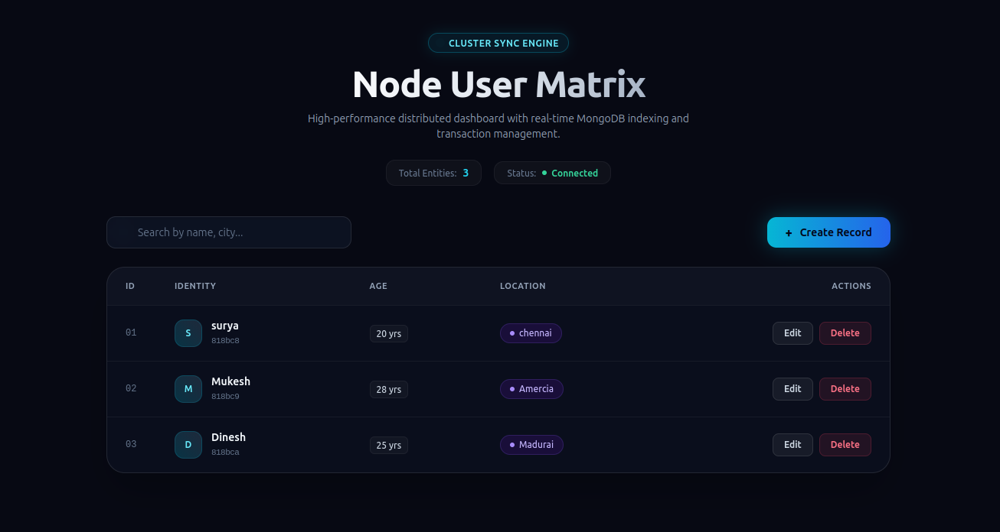
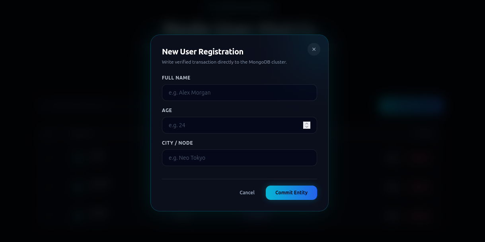
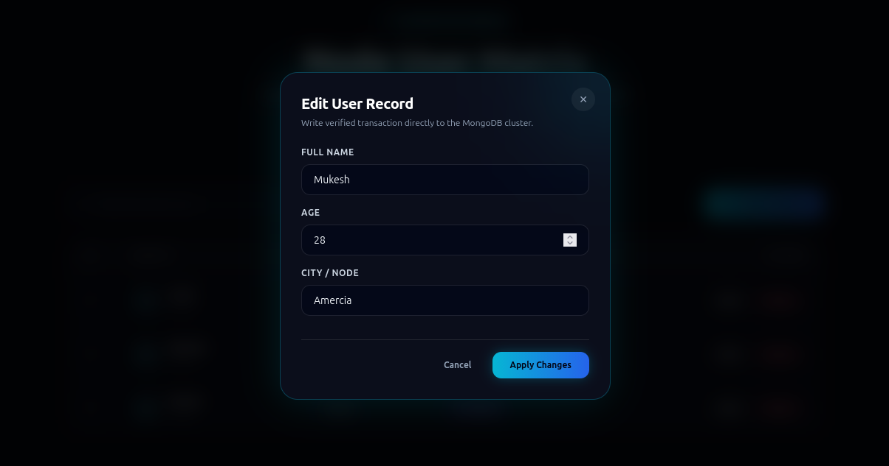

# MERN-CRUD-APP
# ⚡ Node User Matrix — MERN CRUD Application

A modern, high-performance Full-Stack MERN (MongoDB, Express, React, Node.js) CRUD management application built with a responsive Cyber-Glassmorphism dashboard interface.

---

## 📸 Application Preview

### Dashboard Overview
The main interface displays live user records directly synchronized with MongoDB, featuring real-time client-side search filtering, record metrics, and quick CRUD actions.

<p align="center">
  
</p>

---

### Modal Interactions

| Create Record Modal | Edit Record Modal |
| :---: | :---: |
|  |  |

---

## 🛠️ Tech Stack

### Frontend
- **Framework**: React 19 (Vite)
- **Styling**: Tailwind CSS (Cyber-Glassmorphism theme)
- **HTTP Client**: Axios
- **Tooling**: Vite Dev Server Reverse Proxy

### Backend
- **Runtime**: Node.js
- **Server Framework**: Express.js
- **Database ODM**: Mongoose
- **CORS Handling**: CORS middleware

### Database
- **Database Engine**: MongoDB (Local Instance on port `27017`)

---

## 📁 Project Directory Structure

```text
MERN-CRUD-APP/
├── assets/
│   ├── nodeUserMat.png
│   ├── NUM-add.png
│   └── NUM-Edit.png
├── backend/
│   ├── models/
│   │   └── User.js
│   ├── index.js
│   └── package.json
└── frontend/
    ├── src/
    │   ├── App.jsx
    │   ├── index.css
    │   └── main.jsx
    ├── index.html
    ├── package.json
    ├── tailwind.config.js
    └── vite.config.js
